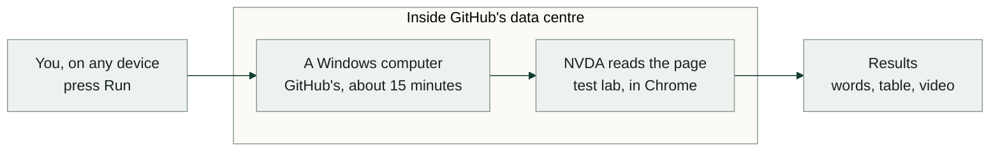

# Real NVDA on GitHub's Windows computers

**Status: built.** The [Real screen readers](../.github/workflows/real-screen-readers.yml) workflow runs it. This is audit item A18 in [the home-grown code audit](audits/home-grown-code.md#a18-a-real-screen-reader); the owner decided on 17 October 2026 that it was the next step: "that will be great as a next step". This page holds how it works and the research behind it, checked against each tool's current source and docs on that date. The picture version is on AEE's website as [Real NVDA, next to AEE's reader](https://elizabeth1979.github.io/accessibility-evidence-engine/real-screen-readers.html) (`site/real-screen-readers.html`).

## Why

AEE's virtual screen reader is a simulation. It speaks through Guidepup's virtual screen reader, which follows the W3C mappings, but it is not NVDA or JAWS, and those are the readers the owner tests for. Until now the only real reader compared with it was VoiceOver on the owner's Mac. The plan puts real NVDA next to AEE's reader on the test lab page, so every difference shows.

## No Windows computer needed

GitHub runs automated jobs on its own computers. AEE already uses this: every proposed change starts a Linux computer in GitHub that builds AEE and runs its tests. GitHub also has Windows computers for this, free for public repositories. The plan runs NVDA on one of those, so nobody needs a Windows machine of their own.

What using it looks like:

1. **Start a run.** In GitHub, open the **Actions** tab, pick **Real screen readers** and press **Run workflow**. A short form lets you tick which readers to run and how many retries to allow (see [Choices when you run it](#choices-when-you-run-it)). It also starts by itself when a pull request changes the reader code, and once a week. A browser on any device will do.
2. **Wait about 15 minutes.** GitHub sets up the Windows computer, installs NVDA, opens the test lab page in Chrome and lets NVDA read it from top to bottom with the Down Arrow, the way a user would. AEE's virtual reader reads the same page. Guidepup presses the keys and writes down what NVDA says, so nobody sits at that computer.
3. **See the result.** Open the finished run. The side-by-side table is on the run's own page, under **Side by side**. The attachments at the bottom hold the rest: NVDA's words, AEE's words and a video of the Windows screen with NVDA's Speech Viewer showing each phrase as it is spoken.

The run cannot be watched live; the video is how you see it.

## What a run produces

Each reader's job saves an attachment named after it (`readers-nvda`, `readers-voiceover`):

- `comparison.md` and `comparison.json`: what AEE's virtual reader and that real reader said, lined up two ways, with the words only one of them said, why the real reader's walk ended and which attempt it came from.
- `real-reader.mp4`: the whole screen while the real reader reads.

The **Side by side** job then puts every reader that ran in one table, `combined.md`: a column for AEE's reader, and for each real reader what it said and what differs. It is also shown on the run's page and saved as the `side-by-side` attachment. Rows are matched by meaning, not by step number: "heading, level 1, Workspace overview" sits next to "heading, Workspace overview, level 1", and every word counts, including role and state words such as "pressed" and "not checked". A row can hold several of AEE's steps, since NVDA names a landmark, a list and the first thing inside in one phrase where AEE's reader takes a step for each: jsdiff aligns the two transcripts word by word, forwards and backwards, keeps the links both directions agree on, and each row is the smallest run of phrases on each side that no link leaves (how machine translation takes phrase pairs from a word alignment). When NVDA reaches the end of the page it reads the last line again at each further step, since it cannot move on; those repeats end the walk and are left out of the rows. The counts say how each reader differs from AEE's, not which one is right. When a reader fails to start, Playwright's trace is saved as `debug-nvda` or `debug-voiceover`.

The same commands run on any machine with a real reader: `npm run readers:compare` reads the page with the reader on that machine (with `AEE_READERS_RECORD=1` it also records the screen), and `npm run readers:combine` puts the comparisons found under `test-results/readers-runs/` (or `AEE_READERS_RUNS`), one folder each, in one table.

## What the first run showed

On 17 October 2026, on this workflow's own pull request, NVDA 2026.2 read the whole test lab page in Chrome on Windows 11 in 28 steps, on its first attempt, then said "No changes made." again at each of the next 3 steps; AEE's virtual reader took 91. NVDA names the containers in the same breath as the first thing inside ("main landmark, Breadcrumb, navigation landmark, list, with 2 items, link, Test lab"), and that phrase now sits next to the five AEE steps it covers. Of the 72 rows, 14 have the same words, 12 are about the same item in different words, 2 only NVDA said ("edit", its word for the search box, and its description hint for the unlabelled image) and 44 only AEE's reader said. Most of AEE's own rows are steps NVDA does not take: AEE says where each list item, paragraph and region ends, and enters each list item and paragraph on a step of its own. Before rows could hold several steps, the same run lined up as 97 rows: 14, 11, 6 and 66.

On the page's planted issues:

- **A link with no name:** NVDA reads out where it goes, "same page, link, test-case projects-heading"; AEE says only "link".
- **An image with no description:** NVDA says "Unlabeled graphic, To get missing image descriptions, open the context menu."; AEE says "image".
- **A box styled as a button:** NVDA says "clickable, Export report"; AEE reads only its text.
- **A heading with no words:** AEE says "heading, level 2"; NVDA skips it.
- **A button with no name:** both say only "button".
- **An unnamed form:** NVDA calls it a "section"; AEE says "form".

The website page shows these rows; the run's `readers-nvda` attachment has all of them and the video.

Only the public test lab page (`site/test-case.html`) is read. The workflow takes no page address, so no private page's words can reach GitHub's public logs, in line with [Evidence privacy](privacy.md).

## Research findings

Each claim below was checked in the tool's source or docs on 17 October 2026.

### Installing NVDA

- **`@guidepup/setup` (0.29.3) installs NVDA with its `install` command.** It reads `manifest.json` from the installed `@guidepup/guidepup` and downloads the NVDA build listed there from GitHub Releases ([`download-assets.ts`](https://github.com/guidepup/setup/blob/main/src/commands/install/download-assets.ts)). For Guidepup 0.36.3 that is [`guidepup/nvda` release `0.2.1-2026.2`](https://github.com/guidepup/nvda/releases/tag/0.2.1-2026.2): a portable NVDA 2026.2, about 100 MB, checked against a sha256 fingerprint before use. The NVDA version therefore changes only when AEE's lockfile moves to a newer Guidepup.
- **Its `setup` command does nothing on Windows.** The Windows branch of [`setup/index.ts`](https://github.com/guidepup/setup/blob/main/src/commands/setup/index.ts) is empty; `setup` prepares macOS for VoiceOver.
- **The portable build is stock NVDA with a settings file.** [`guidepup/nvda`](https://github.com/guidepup/nvda) builds it from the latest NV Access release with NVDA's own `--create-portable-silent`. Its [`nvda.ini`](https://github.com/guidepup/nvda/blob/main/overrides/userConfig/nvda.ini) turns on NVDA's built-in Remote Access as a local server, uses the OneCore voice, opens the Speech Viewer at start-up, and turns off update checks and reading the whole page on load. No add-on and no registry changes.
- **The setup GitHub Action is retired.** [`guidepup/setup-action`](https://github.com/guidepup/setup-action) says to use the `@guidepup/setup` command directly.
- **No install scripts.** `@guidepup/setup` and its dependencies (`chalk`, `commander`, `semver`, `undici`, `unzipper`) run nothing on install, so AEE keeps installing packages with `npm ci --ignore-scripts`.
- **Licence.** NVDA is GPL-2, which puts no limit on running it in CI. The download comes from GitHub Releases on `guidepup/nvda`, not from NV Access's servers.

### How Guidepup hears NVDA

- **It reads NVDA's speech as text, not audio.** Guidepup's [`NVDAClient`](https://github.com/guidepup/guidepup/blob/main/src/windows/NVDA/NVDAClient.ts) connects to NVDA's Remote Access server on the same computer (port 6837) as the controlling side, over TLS, and collects each `speak` message. That is why it works on a computer with no sound card.
- **What a phrase looks like.** The parts of one utterance are joined with ", " and the utterances of one key press with ". ", so NVDA comes out as, for example, "Breadcrumb navigation landmark, list with 2 items, link, Test lab": NVDA names a region and a list in the same breath as the first item inside, where AEE's reader takes a step for each.
- **Keys go over the same connection.** `next()` sends Down Arrow, NVDA's "next item" in browse mode.
- **Known limits.** Speech NVDA makes between Guidepup's commands, such as a late live-region announcement, is dropped ([guidepup#183](https://github.com/guidepup/guidepup/issues/183), open). Reading with `capture: true`, as AEE already does, avoids phrases cut off at a full stop ([guidepup#115](https://github.com/guidepup/guidepup/issues/115)).

### Driving NVDA from Playwright

- **`screenReaderTest` from `@guidepup/playwright` (0.20.0) picks NVDA on Windows by itself** (`nvda.default()` is "is this Windows?"). AEE's `npm run readers:compare` already uses it for VoiceOver, and `tests/reader-comparison.ts` already names the Windows reader NVDA.
- **`navigateToWebContent` works with NVDA and Chromium.** It finds the browser window by its title ("Google Chrome For Testing"), switches to it with Alt+Escape, settles NVDA in browse mode and moves to the top of the page ([`navigateNVDAtoWebContent.ts`](https://github.com/guidepup/guidepup-playwright/blob/main/src/navigateNVDAtoWebContent.ts)).
- **The browser must be visible.** Guidepup's `withGuidepup` config forces `headless: false`, because a screen reader reads a window it can see. AEE's `compare` project already sets it.

### The precedent for each setup step

Guidepup runs NVDA on GitHub's Windows computers in its own tests. These workflows are the model:

- [`guidepup-playwright/.github/workflows/test-nvda.yml`](https://github.com/guidepup/guidepup-playwright/blob/main/.github/workflows/test-nvda.yml): check out, set up Node, install packages, `@guidepup/setup install`, run the tests, upload `test-results` as an attachment.
- [`guidepup/.github/workflows/playwright-nvda.yml`](https://github.com/guidepup/guidepup/blob/main/.github/workflows/playwright-nvda.yml): the same, plus `npm rebuild ffmpeg-static`, which `@guidepup/record` needs to record the screen.
- [guidepup.dev's CI guide](https://www.guidepup.dev/docs/getting-started/ci-cd) recommends caching the downloaded screen reader, keyed by version.

Two things in those workflows AEE does not copy. They run `npx` with `--min-release-age=0 --ignore-scripts=false`; AEE needs neither, and both loosen npm's safety settings. AEE also pins `@guidepup/setup` and `@guidepup/record` in its lockfile, where npm checks their integrity, instead of fetching them with `npx` on each run. The one install script AEE runs is the screen recorder's ffmpeg (`npm rebuild ffmpeg-static`), named on its own as in Guidepup's `playwright-nvda.yml`; every other package still installs with `npm ci --ignore-scripts`.

Guidepup's example Playwright config retries a failed test up to five times, because NVDA on a fresh computer sometimes fails to start. AEE makes the number a choice on the run form (below).

### JAWS

**JAWS can be driven automatically, but it needs a paid licence and a different tool from Guidepup, so this plan leaves it out.**

- **Guidepup does not drive JAWS.** It supports NVDA, VoiceOver and Orca ([support matrix](https://www.guidepup.dev/docs/reference/support-matrix)). Its request for JAWS, [guidepup#125](https://github.com/guidepup/guidepup/issues/125), is still open, and the maintainer questions whether JAWS's licence allows it.
- **JAWS itself now has a way in.** JAWS includes a "Remote Command Server" that speaks W3C's AT-Driver protocol, a standard way for software to press keys in a screen reader and read back what it says. It is switched on when JAWS is installed (the installer setting `REMOTECOMMANDSERVER=1`) and listens on port 9002 of the same computer.
- **W3C's screen-reader test project already uses it in GitHub.** ARIA-AT runs JAWS 2025 on GitHub's Windows computers through that server ([`bocoup/aria-at-gh-actions-helper`, `JAWS/`](https://github.com/bocoup/aria-at-gh-actions-helper/tree/main/JAWS)); its team said in November 2025 that AT-Driver is implemented in NVDA, macOS and JAWS ([ARIA-AT minutes](https://www.w3.org/2025/11/12-aria-at-minutes.html)). Its README says the run "needs a valid `JAWS.lic` file", which it keeps encrypted.
- **What it would take for AEE:** a JAWS licence whose terms allow this use (to be checked with Vispero, JAWS's maker), kept as a GitHub secret and never in the repository; and an AT-Driver client in place of Guidepup for that one reader. That is its own piece of work, question 4 below.

## Choices when you run it

The owner decided on 17 October 2026 that these are choices for whoever runs it, any or all, not one fixed setting.

- **When it runs: all three ways.** By itself when a pull request changes the reader code, by itself once a week (which catches a new Chrome), and whenever someone presses **Run workflow**. The automatic runs use the defaults below.
- **Which real readers: tick any or all.** The **Run workflow** form has a tick box for each reader: NVDA, ticked by default, and VoiceOver on GitHub's Mac computers, as Guidepup's own [`test-voiceover.yml`](https://github.com/guidepup/guidepup-playwright/blob/main/.github/workflows/test-voiceover.yml) runs it. The side-by-side page gets a column for each reader that ran.
- **Retries: a number on the form.** How many times to try again if a reader fails to start, from 0 to 5; the default is 2, and Guidepup's own setup uses 5. The run page says plainly when a retry was needed. A retry never changes what a reader says, only whether the run gets going.

## Open question

**JAWS through its own Remote Command Server?** It would put the reader the owner cares about next to NVDA, but it needs a JAWS licence that allows running it on GitHub's computers. Worth asking Vispero what their terms allow before any code.
